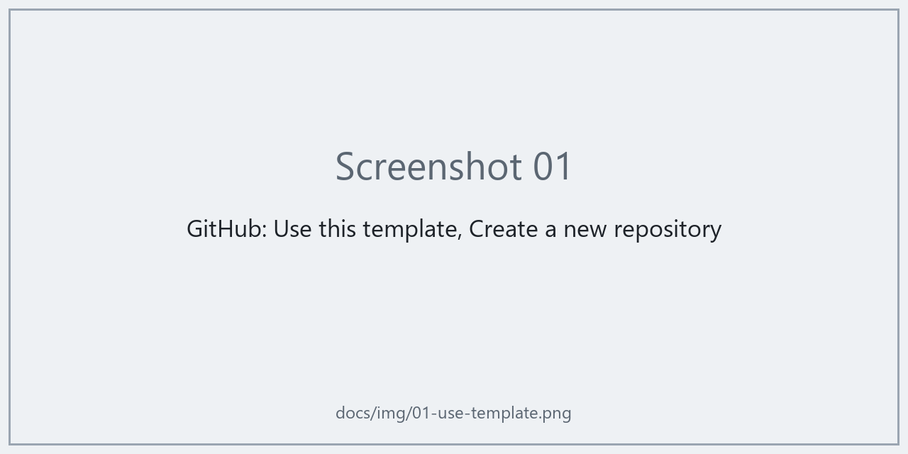
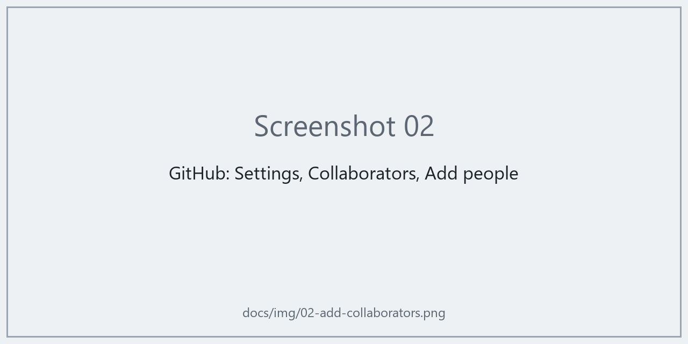
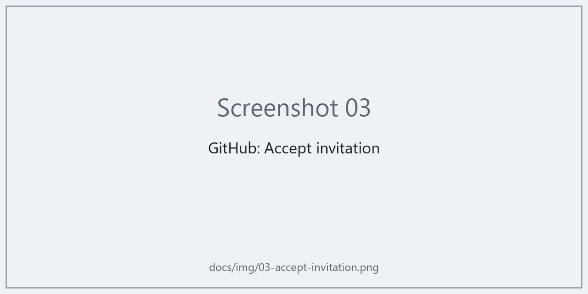
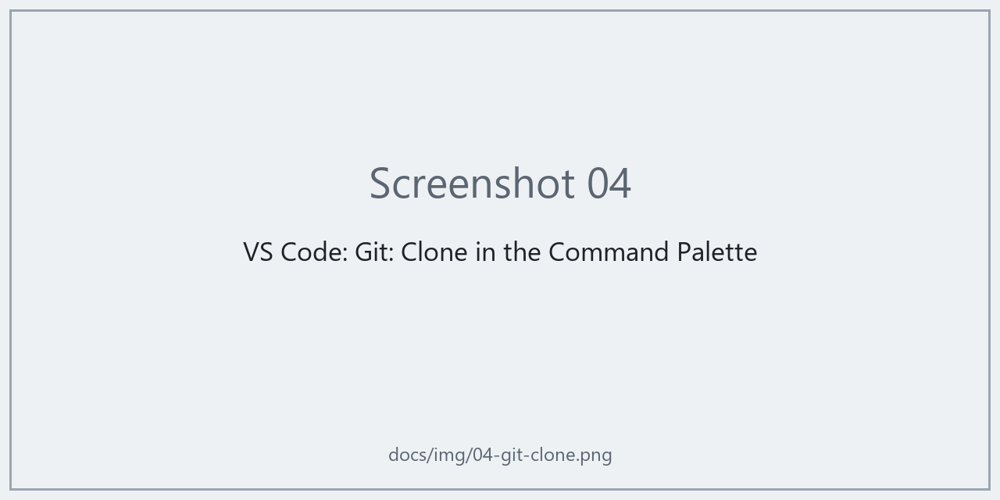
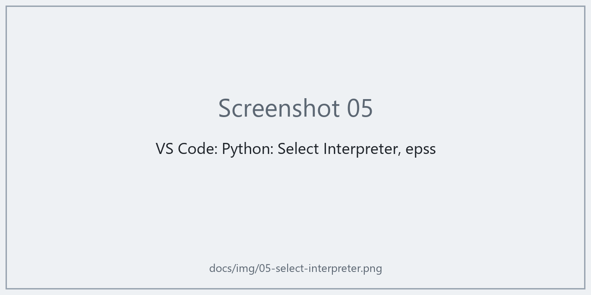
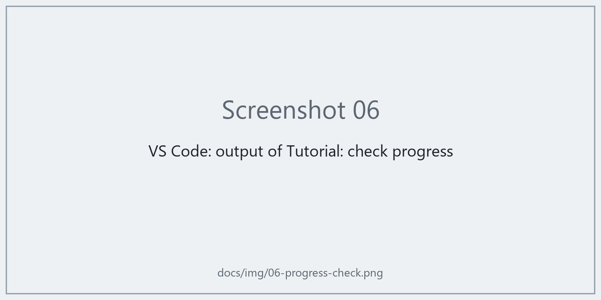

# Part 0 · Getting ready (15 min)

You are three people, **A**, **B** and **C**, sitting together. In about 90 minutes you will build a tiny weather-station toolkit together, and on the way meet (and solve) every situation that normally goes wrong when a group shares code.

**How to read this guide**

- Every line with a box is one action. The letter says who does it: **A**, **B**, **C**, or **All**.
- When it is not your letter, watch your teammate's screen. Your turn comes.
- Do the steps in order and wait for each other. Several steps only work if the previous person has finished.
- Groups of four or five: three people take the roles; the others sit with a member, follow along and swap in afterwards.
- Keyboard shortcuts are for Windows. On a Mac, read **Cmd** where it says **Ctrl**.

**The whole idea in four lines**

```text
your files  --commit-->  your repository  --push-->  GitHub
  (folder)               (on your computer)           (shared by the group)
                                          <--pull--
```

A **commit** saves a snapshot on your computer. A **push** sends your commits to GitHub. A **pull** brings your teammates' commits to you. Nothing is shared until it is pushed.

## Before the session (each person, at home)

- [ ] **All** Anaconda with the `epss` environment, VS Code (with the *Python* and *Jupyter* extensions) and Git are installed, as in the course installation guide.
- [ ] **All** You have a GitHub account and remember your user name. The email address of the account is verified (GitHub sent you a link when you registered).

## 0.1 Tell Git who you are

Git stamps your name and email on every commit. GitHub uses the email to link the commit to your account.

- [ ] **All** Open VS Code. Menu **Terminal › New Terminal**.
- [ ] **All** Type these three lines, one at a time, with **your** name and **the email of your GitHub account**. Press Enter after each.

  ```text
  git config --global user.name "Ana Silva"
  git config --global user.email "ana.silva@tecnico.ulisboa.pt"
  git config --global pull.rebase false
  ```

- [ ] **All** Check: type `git config --global --list`. Your name, your email and `pull.rebase=false` are in the list.

The third line tells Git what to do when you and a teammate both have new work: combine the two (a *merge*). Without it, Git stops and asks.

<details>
<summary>If it went wrong</summary>

- *`git` is not recognized*: Git is not installed, or VS Code was open while you installed it. Install it from git-scm.com, then close and reopen VS Code.
- You made a typing mistake: type the line again. The new value replaces the old one.

</details>

## 0.2 Create the group repository

A *repository* (repo) is the project folder together with its whole history. Your group needs one on GitHub. Member A makes it from the course template.

- [ ] **A** In the browser, sign in to github.com and open <https://github.com/FORESIGHT-ULisboa/epss-git-tutorial>.
- [ ] **A** Click the green **Use this template** button, then **Create a new repository**.
- [ ] **A** *Owner*: yourself. *Repository name*: `epss-git-tutorial-g07` (with your group number). Choose **Public**. Leave *Include all branches* unticked. Click **Create repository**.



- [ ] **A** In the new repository: **Settings › Collaborators › Add people**. Type B's GitHub user name, select it, **Add to repository**. Do the same for C.



- [ ] **A** Copy the address of the repository page (`https://github.com/your-name/epss-git-tutorial-g07`). Paste it into the class sheet your teacher shared, and send it to B and C.
- [ ] **B + C** Open the address A sent and add `/invitations` at the end, or open the email GitHub just sent you. Click **Accept invitation**.



<details>
<summary>If it went wrong</summary>

- *No invitation*: A checks the spelling of the user name in **Settings › Collaborators**; the invitation is listed there as pending.
- B or C skips this step: everything works until their first push, which GitHub then refuses.

</details>

## 0.3 Clone: get your own copy

To *clone* is to copy the repository, with its history, from GitHub to your computer. You do it once.

- [ ] **All** On the repository page, click the green **Code** button, tab **HTTPS**, and copy the address.
- [ ] **All** In VS Code press **Ctrl+Shift+P**, type `Git: Clone`, press Enter, paste the address, press Enter.



- [ ] **All** Choose a folder on your own disk, for example `C:\work`. **Not** inside OneDrive, Dropbox, Google Drive or Teams: they and Git damage each other's files.
- [ ] **All** Click **Open** when VS Code asks, then **Yes, I trust the authors**.
- [ ] **All** Press **Ctrl+Shift+P**, type `Python: Select Interpreter`, press Enter and choose **epss**.



You now have the same files on three computers. Look at the bottom-left corner of VS Code: it says `main`. That is the *branch* you are on; more about branches in Part 2.

## 0.4 Check your progress

The repository can check by itself how far your group is.

- [ ] **All** Click the **Source Control** icon in the left bar (or **Ctrl+Shift+G**). It is empty: nothing has changed since the last commit. You will use this view all the time.
- [ ] **All** Menu **Terminal › Run Task…** and choose **Tutorial: check progress**.



The check lists eight checkpoints for the group, then the state of your own computer. The link on its last line is your group's progress page.

<!-- checkpoint: repo -->
> **Checkpoint 1.** The check shows `[x] 1  Group repository created from the template` on all three computers.

<details>
<summary>If it went wrong</summary>

- *Run Task shows nothing or fails*: you skipped `Python: Select Interpreter`, or opened the wrong folder. Use **File › Open Folder** and pick the folder that Git created (it contains `TEAM.md`).

</details>

Next: [Part 1 · Warm-up on main](1-warm-up-on-main.md)
