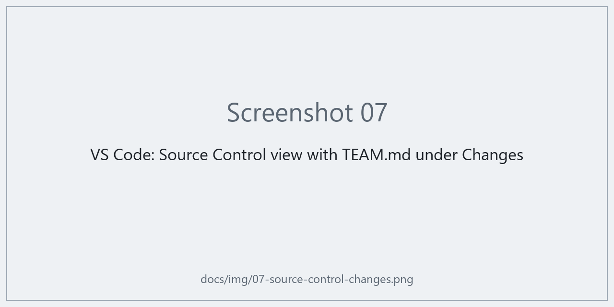
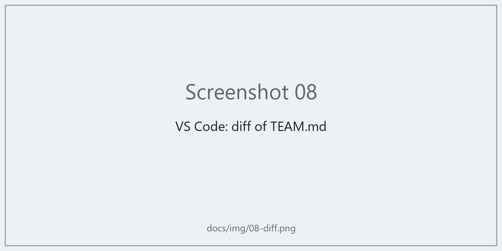
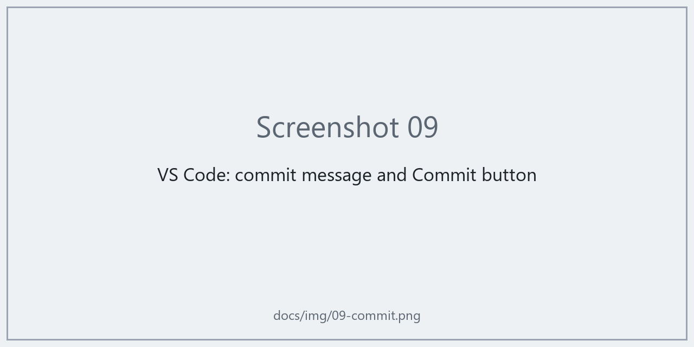
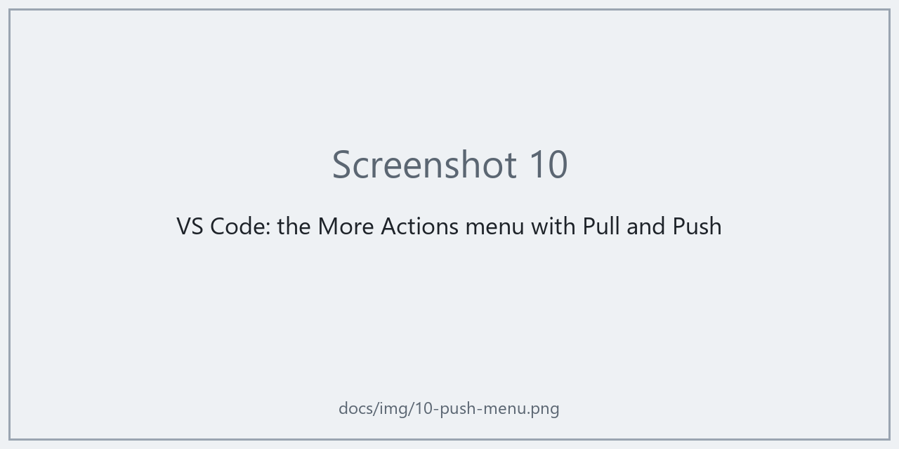
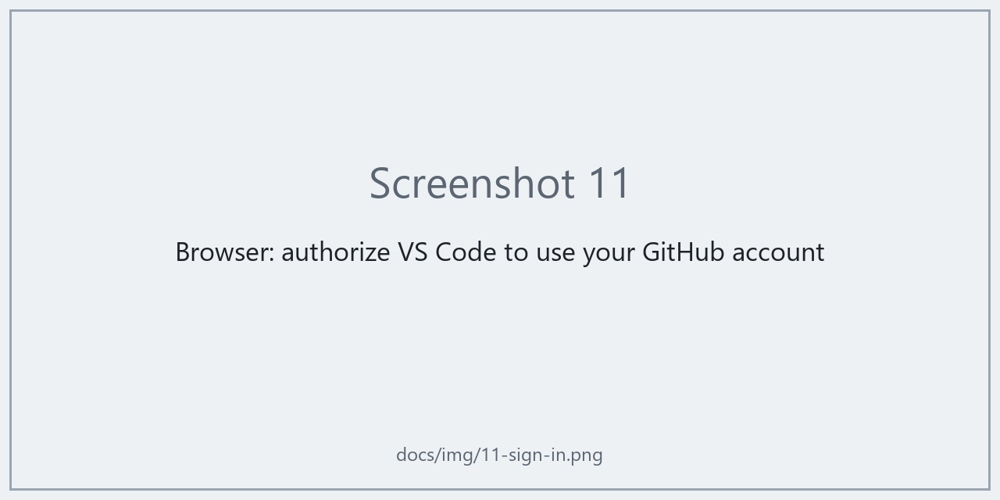
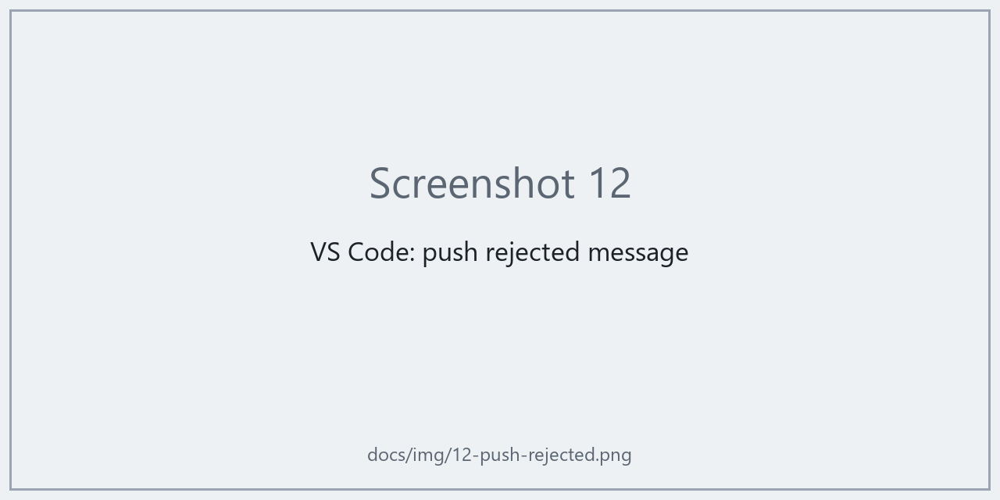
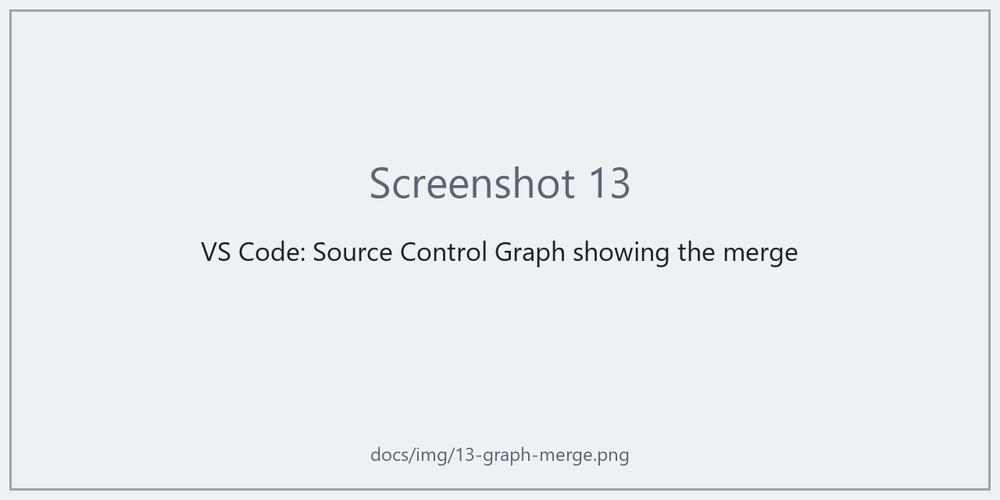
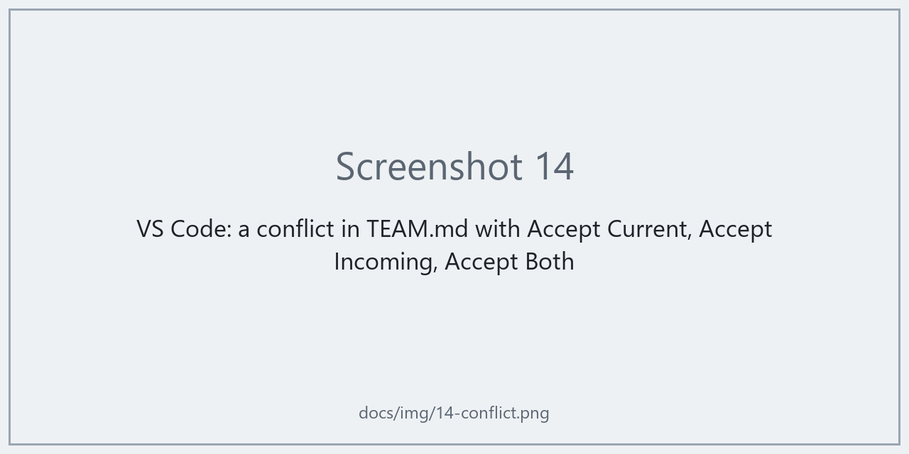
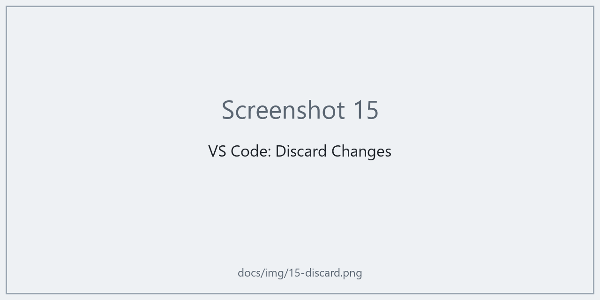

# Part 1 · Warm-up on main (25 min)

For now everybody works directly on the shared branch, `main`. It is the simplest way, and it shows quickly why groups need something better. In Part 2 you switch to that better way.

All the work happens in one small file, `TEAM.md`.

## 1.1 The first commit and push

Member A goes through the full loop once: **edit → look → stage → commit → push**. B and C watch.

- [ ] **A** In the Explorer, open `TEAM.md`. Under *Member A*, replace each `...` with your details. Save (**Ctrl+S**).
- [ ] **A** Open the **Source Control** view. `TEAM.md` is listed under **Changes** with an **M** (modified).



- [ ] **A** Click `TEAM.md` in that list. You see the *diff*: the old version on the left, yours on the right. Always read it before you commit.



- [ ] **A** Move the mouse over `TEAM.md` in the list and click **+** (*Stage Changes*). The file moves to **Staged Changes**: it will be part of the next commit.
- [ ] **A** Type a message in the box above: `Add member A to the team`. Click **Commit**.



The commit now exists, but only on A's computer. The button says **Sync Changes 1↑**: one commit waiting to go up.

- [ ] **A** Click the **`···`** menu at the top of the Source Control view, then **Push**.



- [ ] **A** The first time, VS Code asks to sign in to GitHub. Click **Allow**; a browser page opens; sign in and click **Authorize**; go back to VS Code. (On some computers a small *Connect to GitHub* window appears instead: choose **Sign in with your browser**.)



- [ ] **A** Refresh the repository page in the browser. `TEAM.md` shows your details and your commit message.
- [ ] **B + C** In the Source Control view: **`···` › Pull**. Open `TEAM.md`: A's details have arrived.

<!-- checkpoint: first-push -->
> **Checkpoint 2.** A's details are in `TEAM.md` on github.com and on all three computers.

<details>
<summary>If it went wrong</summary>

- *Commit does nothing or asks about staging*: nothing was staged. Click **+** on the file first.
- *Author identity unknown*: go back to step 0.1.
- *Push fails with 403 or "permission denied"*: you signed in with a different GitHub account, or (for B and C later) the invitation was not accepted.

</details>

## 1.2 Two people at once: the rejected push

Now B and C work at the same moment, as happens in any group.

- [ ] **B + C** At the same time: fill in **your own** section of `TEAM.md`, save, stage (**+**) and commit with the message `Add member B to the team` (C: `member C`). **Do not push yet.**
- [ ] **B** **`···` › Push**. It works. Tell C.
- [ ] **C** **`···` › Push**. GitHub refuses: *Can't push refs to remote. Try running "Pull" first to integrate your changes.*



Nothing is lost. GitHub has a commit (B's) that C does not have yet, and it never lets you overwrite a teammate's work. The cure is always the same: **pull first, then push**.

- [ ] **C** **`···` › Pull**. Git brings B's commit and combines it with yours. This works by itself because you changed different lines. Open `TEAM.md`: both sections are filled in.
- [ ] **C** **`···` › Push**. Now it works.
- [ ] **A + B** **`···` › Pull**.
- [ ] **All** At the bottom of the Source Control view, open **Graph**. The history splits in two and joins again, at a commit called *Merge branch 'main' of …*. That joining commit is a **merge**.



From now on you may use the blue **Sync Changes** button instead: it does a pull and then a push in one click.

<!-- checkpoint: everyone -->
> **Checkpoint 3.** All three sections are filled in on github.com, and the Graph shows a merge.

## 1.3 Two people, the same line: a conflict

Git can combine changes to different lines. When two people change the **same** line, it cannot know who is right. It stops and asks you. That is a *conflict*. It is normal, and solving it takes a minute.

- [ ] **A + B** **Without telling each other what you write**: in `TEAM.md`, replace `(to be decided)` on the `Team name:` line by a name you like. Save, stage, commit with the message `Choose a team name`. Do not push yet.
- [ ] **A** **`···` › Push**. It works. Tell B.
- [ ] **B** **`···` › Push**: refused, as before. So **`···` › Pull**. This time VS Code reports a conflict, and `TEAM.md` appears under **Merge Changes** with a **!**.
- [ ] **B** Click `TEAM.md`. Git has put both versions in the file:

  ```text
  <<<<<<< HEAD
  Team name: The Cumulonimbus           (Current Change: yours)
  =======
  Team name: Rain Check                 (Incoming Change: your teammate's)
  >>>>>>> 3f9e0c2
  ```



- [ ] **All** Agree on one name. This is the real work: a conflict is a question for people, not for Git.
- [ ] **B** Click **Accept Current Change** or **Accept Incoming Change** just above the block. (Or type the agreed name yourself and delete the three marker lines.) No line starting with `<<<<<<<`, `=======` or `>>>>>>>` may remain. Save.
- [ ] **B** Click **+** on `TEAM.md`: this tells Git the conflict is solved. Click **Commit** (the message is already written), then **Sync Changes**.
- [ ] **A + C** **`···` › Pull**. Everybody has the agreed name.

<!-- checkpoint: conflict -->
> **Checkpoint 4.** One team name on github.com, and no marker lines anywhere.

<details>
<summary>If it went wrong</summary>

- *Lost in the middle of the conflict*: press **Ctrl+Shift+P**, type `Git: Abort Merge`, Enter. Everything is back as it was before the pull. Then pull again and take it slowly.
- *VS Code opened a view with three panes*: that is the Merge Editor, a bigger tool for the same job. Tick the version to keep, then **Complete Merge**.

</details>

## 1.4 Throwing away a change

- [ ] **All** Type some nonsense anywhere in `TEAM.md` and save. The file is back under **Changes**.
- [ ] **All** Move the mouse over it and click the curved arrow, **Discard Changes**. Confirm. The file is exactly as in the last commit.



Discard only works on changes that are **not committed**, and it cannot be undone.

**What Part 1 showed.** Working on `main` all together functions, but every push is a small race, and half-finished work lands in everybody's copy at the next pull. With three people and a deadline it gets uncomfortable. Part 2 is the way out.

Next: [Part 2 · Branches and pull requests](2-branches-and-pull-requests.md)
