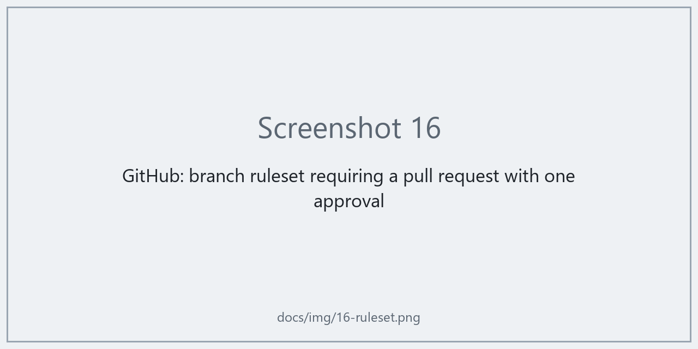
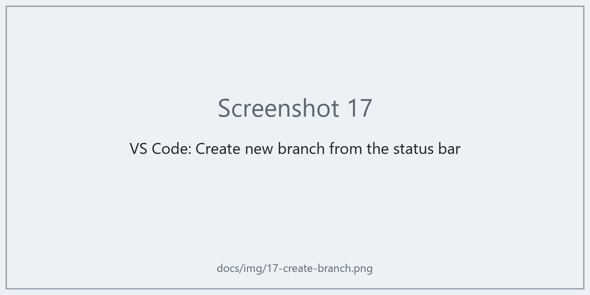
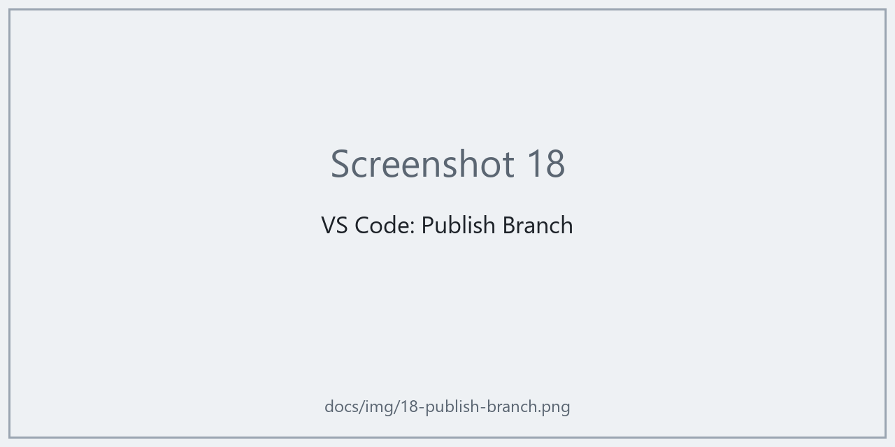
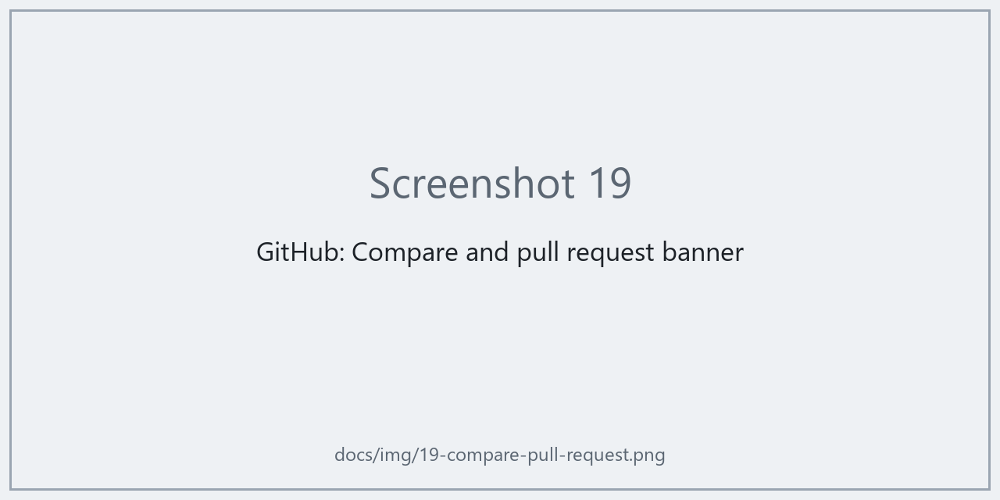
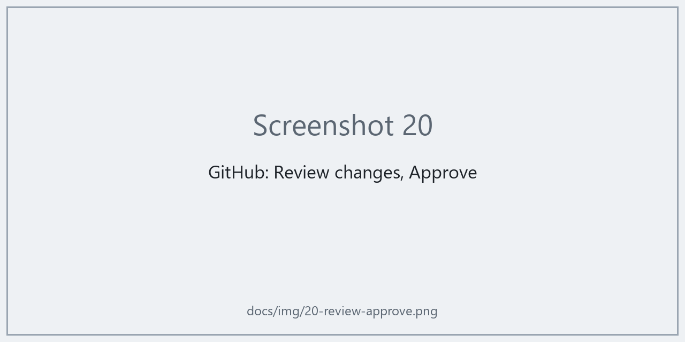
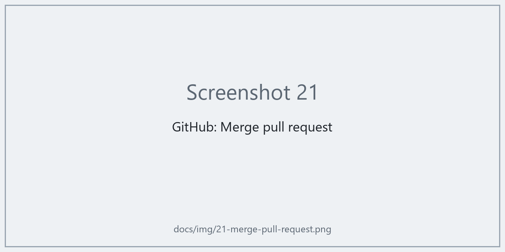
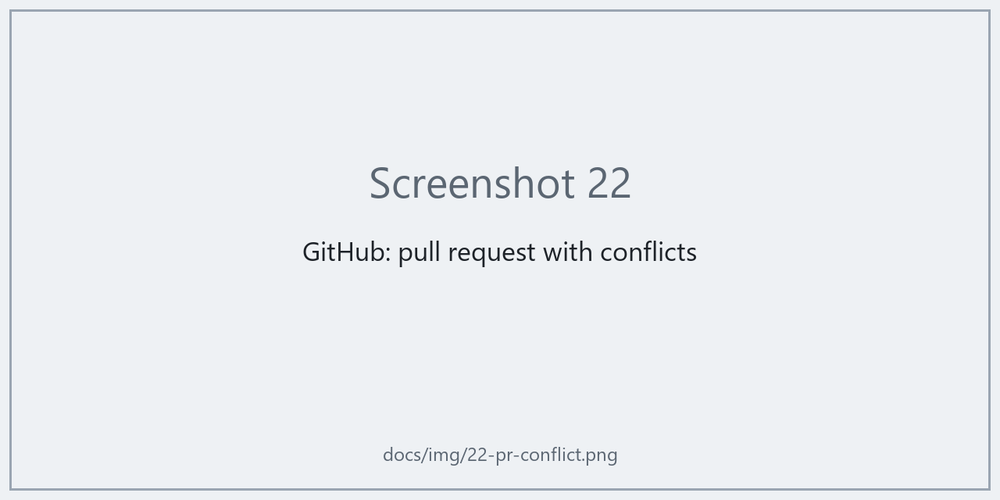
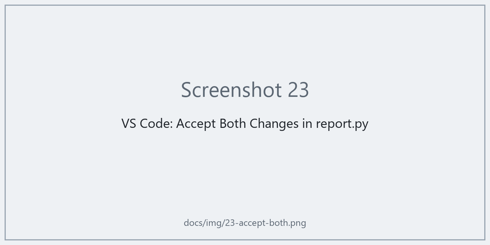

# Part 2 · Branches and pull requests (30 min)

This is how groups really work, and how you should work on your project from now on.

- A **branch** is your own line of commits. You work on it without disturbing anyone, and `main` stays in working order.
- A **pull request** (PR) is a page on GitHub that says: *please merge my branch into `main`*.
- A **review** is a teammate reading your changes on that page and approving them. Then the branch is merged.

Each of you writes one small function, on your own branch:

| Member | Branch | File | Function |
|---|---|---|---|
| A | `feature/stats` | `weather/stats.py` | `monthly_summary` |
| B | `feature/temperature` | `weather/temperature.py` | `add_tmean` |
| C | `feature/plots` | `weather/plots.py` | `plot_temperature` |

## 2.1 Protect main

First, make the good habit a rule: from now on GitHub refuses any change to `main` that does not come through an approved pull request.

- [ ] **A** On the repository page: **Settings › Rules › Rulesets › New ruleset › New branch ruleset**.
- [ ] **A** *Ruleset name*: `protect main`. *Enforcement status*: **Active**.
- [ ] **A** Under *Target branches*: **Add target › Include default branch**.
- [ ] **A** Tick **Require a pull request before merging** and set **Required approvals** to **1**. Leave the rest as it is. Click **Create**.



<!-- checkpoint: protected -->
> **Checkpoint 5.** `main` is protected. (Your own computer cannot always see this: the progress page and the Actions tab on GitHub can.)

## 2.2 One branch per task

- [ ] **All** Check that the bottom-left corner says `main`, then **`···` › Pull**, so that you start from the latest version.
- [ ] **All** Click `main` in the bottom-left corner, choose **Create new branch…**, type your branch name from the table above, press Enter. The corner now shows your branch.



- [ ] **A** Open `weather/stats.py`. Select everything (**Ctrl+A**) and paste this over it. Save.

  <!-- snippet: weather/stats.py -->
  ```python
  """Member A: monthly statistics."""


  def monthly_summary(df):
      """One row per month: mean tmin_c, mean tmax_c and total rain_mm."""
      monthly = df.resample("MS").agg({"tmin_c": "mean", "tmax_c": "mean", "rain_mm": "sum"})
      return monthly.round(1)
  ```

- [ ] **B** Open `weather/temperature.py`. Select everything (**Ctrl+A**) and paste this over it. Save.

  <!-- snippet: weather/temperature.py -->
  ```python
  """Member B: mean temperature."""


  def add_tmean(df):
      """Copy of df with a new column tmean_c = (tmin_c + tmax_c) / 2."""
      out = df.copy()
      out["tmean_c"] = (out["tmin_c"] + out["tmax_c"]) / 2
      return out
  ```

- [ ] **C** Open `weather/plots.py`. Select everything (**Ctrl+A**) and paste this over it. Save.

  <!-- snippet: weather/plots.py -->
  ```python
  """Member C: plots."""
  from pathlib import Path


  def plot_temperature(df, path="outputs/temperature.png"):
      """Save a plot of daily tmin_c and tmax_c to path and return path."""
      ax = df[["tmin_c", "tmax_c"]].plot(figsize=(9, 4), ylabel="°C", title="Daily temperature")
      Path(path).parent.mkdir(exist_ok=True)
      ax.figure.savefig(path, dpi=120)
      return path
  ```

A function that nobody calls is of no use. `report.py` is the script that puts the three together.

- [ ] **All** Open `report.py`. Click on the empty line between the two `# --- members` lines and paste **your** two lines there. Save.

  Member A:

  <!-- snippet: report:A -->
  ```python
  from weather.stats import monthly_summary
  print(monthly_summary(df))
  ```

  Member B:

  <!-- snippet: report:B -->
  ```python
  from weather.temperature import add_tmean
  print(add_tmean(df).head())
  ```

  Member C:

  <!-- snippet: report:C -->
  ```python
  from weather.plots import plot_temperature
  print("Plot saved to", plot_temperature(df))
  ```

- [ ] **All** With `report.py` open, click the **Run Python File** button (the triangle, top right). The terminal shows the report with your part in it. Test before you commit, always.
- [ ] **C** Your function wrote `outputs/temperature.png`, yet that file does not appear in the Source Control view. The file `.gitignore` lists what Git must leave out: things the code can make again, and secrets.
- [ ] **All** Source Control view: two files changed. Read both diffs, stage both (**+**), and commit with a message that says what you did, for example `Add monthly_summary and use it in the report`.
- [ ] **All** Click the blue **Publish Branch** button. Your branch, with its commit, is now on GitHub. `main` has not changed.



## 2.3 Open a pull request

- [ ] **All** Open the repository page in the browser. A yellow banner mentions your branch: click **Compare & pull request**. (No banner? Tab **Pull requests › New pull request**, and choose your branch under *compare*.)



- [ ] **All** The title is your commit message. Add a sentence saying what you tested. On the right, under **Reviewers**, choose your reviewer: **B reviews A's**, **C reviews B's**, **A reviews C's**. Click **Create pull request**.

## 2.4 Review a teammate's pull request

- [ ] **All** Tab **Pull requests**: open the one you were asked to review, then its tab **Files changed**.
- [ ] **All** Move the mouse over a changed line, click the blue **+**, write a short comment (a question, a suggestion, or what you like about it), and click **Start a review**.
- [ ] **All** Click the green **Review changes** button (top right), choose **Approve**, then **Submit review**.



## 2.5 Merge, one at a time

Merge in the order A, B, C. Wait for each other.

- [ ] **A** On your pull request: **Merge pull request › Confirm merge**, then **Delete branch**. Your function is on `main`.



- [ ] **B** Look at your pull request now: *This branch has conflicts that must be resolved*. A's two lines and yours are in the same place of `report.py`. You solve it on your own branch, so `main` is never broken.



- [ ] **B** In VS Code (the corner shows `feature/temperature`): **Ctrl+Shift+P**, `Git: Fetch`, Enter. Then **Ctrl+Shift+P**, `Git: Merge…`, Enter, and choose **origin/main**. This brings the new `main` into your branch.
- [ ] **B** `report.py` is under **Merge Changes**. Open it. This time nobody is wrong: both pairs of lines are needed. Click **Accept Both Changes**. Check that no marker line remains, save, and press **Run Python File**: the report shows both parts.



- [ ] **B** Click **+** on `report.py`, then **Commit**, then **Sync Changes**.
- [ ] **B** Back in the browser, the pull request is green. **Merge pull request › Confirm merge › Delete branch**.
- [ ] **C** Your turn, exactly as B did: `Git: Fetch`, `Git: Merge…` with **origin/main**, **Accept Both Changes**, save, run, **+**, **Commit**, **Sync Changes**, then merge your pull request and delete the branch.
- [ ] **All** Go back to `main`: click the branch name in the bottom-left corner and choose `main`, then **`···` › Pull**. Run `report.py`: the three parts are there.
- [ ] **All** Tidy up: **Ctrl+Shift+P**, `Git: Delete Branch…`, and choose your `feature/…` branch. Its commits are safe in `main`.

<!-- checkpoint: prs -->
> **Checkpoint 6.** Three pull requests merged, each approved by a teammate.

<!-- checkpoint: wired -->
> **Checkpoint 7.** On `main`, `report.py` prints the monthly table, the mean temperature and the plot message.

<details>
<summary>If it went wrong</summary>

- *Merge pull request is grey*: the approval is missing, or there are conflicts to solve first.
- *You committed on `main` by mistake and the push is refused*: see the first recipe in Part 4.
- *After Accept Both the report fails*: open `report.py` and compare with a teammate's. Between the two marker comments there must be only complete pairs of lines, one pair per member.
- *VS Code will not switch branch ("your local changes would be overwritten")*: commit your changes first.

</details>

**What Part 2 showed.** The same conflict as in Part 1, but this time it stayed on one person's branch until it was solved, someone else read the code before it was accepted, and `main` worked at every moment.

Next: [Part 3 · Notebooks](3-notebooks.md)
