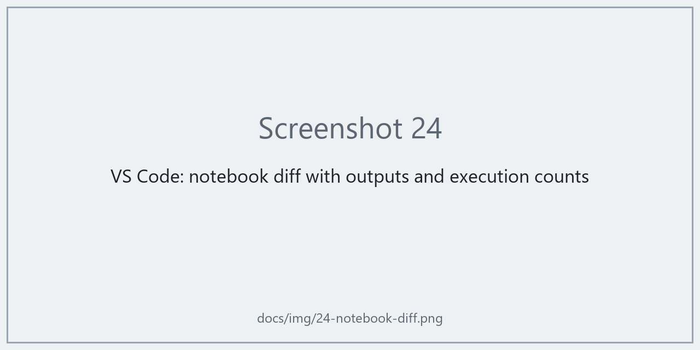
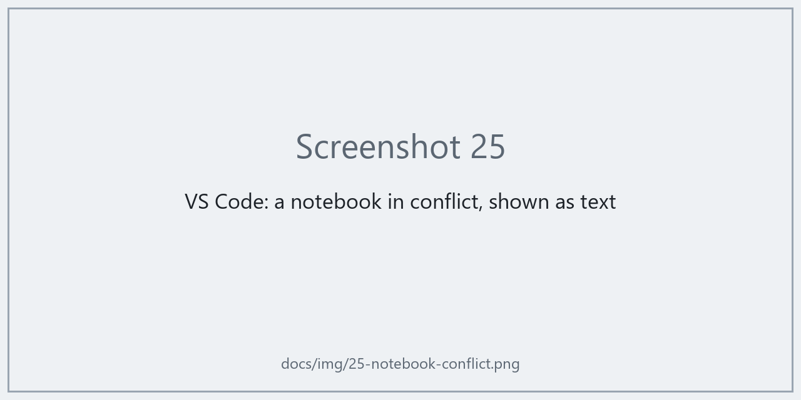

# Part 3 · Jupyter notebooks (12 min)

Notebooks are the place where groups get hurt most. A `.ipynb` file is not only your code: it also stores every output, every plot (as thousands of characters) and a counter for each cell you ran. Git sees all of that as changes.

A and B both edit the shared notebook `analysis.ipynb`. C reviews.

## 3.1 Two people in the same notebook

- [ ] **A + B** On `main`, **`···` › Pull**. Then create a branch (bottom-left corner, **Create new branch…**): A `notebook/monthly-table`, B `notebook/mean-temperature`.
- [ ] **A + B** Open `analysis.ipynb`. Click **Select Kernel** (top right), **Python Environments**, **epss**. Click **Run All**.
- [ ] **A + B** Add a code cell at the very end (**+ Code**), paste your lines, run the cell, and save.

  Member A:

  <!-- snippet: notebook:A -->
  ```python
  from weather.stats import monthly_summary

  monthly_summary(df)
  ```

  Member B:

  <!-- snippet: notebook:B -->
  ```python
  from weather.temperature import add_tmean

  add_tmean(df)["tmean_c"].plot(ylabel="°C", title="Mean temperature");
  ```

- [ ] **A + B** In the Source Control view, click `analysis.ipynb`. You wrote three lines, and the diff shows changes in every cell: outputs, pictures, counters.



- [ ] **A + B** Stage, commit (`Add monthly table to the notebook` / `Add mean temperature plot to the notebook`), **Publish Branch**, and open a pull request with **C** as reviewer.
- [ ] **C** Open both pull requests, tab **Files changed**. Try to read what your teammates did. Then **Review changes › Approve** on both.
- [ ] **A** **Merge pull request › Confirm merge › Delete branch**.
- [ ] **B** Your pull request has conflicts. In VS Code: `Git: Fetch`, then `Git: Merge…` with **origin/main**, as in Part 2.
- [ ] **B** Click `analysis.ipynb` under **Merge Changes**. It no longer opens as a notebook: it is one long text with marker lines somewhere inside. Do not try to repair it by hand.



- [ ] **B** In the Source Control view, right-click `analysis.ipynb` and choose **Accept All Incoming**. You now have the version from `main` (with A's cell), and the notebook opens again. Your own cell is gone.
- [ ] **B** Add your cell again at the end and run it.
- [ ] **B** Click **Clear All Outputs** in the notebook toolbar (it may be behind the **`···`** of that toolbar). Save.
- [ ] **B** Click **+** on `analysis.ipynb`, **Commit**, **Sync Changes**. In the browser: **Merge pull request › Confirm merge › Delete branch**.
- [ ] **All** Back to `main` (bottom-left corner), then **`···` › Pull**. Open the notebook: both new cells, no outputs. **Run All** shows it works.

<!-- checkpoint: notebook -->
> **Checkpoint 8.** On `main`, the notebook has both new cells and no outputs.

<details>
<summary>If it went wrong</summary>

- *No "Accept All Incoming" in the menu*: open a terminal (**Terminal › New Terminal**) and type `git checkout --theirs analysis.ipynb`. It does the same.
- *The notebook still does not open*: `Git: Abort Merge`, then start the merge again.
- *"No module named weather"*: the notebook must stay in the top folder of the repository, next to `report.py`.

</details>

## 3.2 Three rules for notebooks in a group

1. **One owner at a time.** Agree who is editing a notebook, and let nobody else touch it until that person's pull request is merged.
2. **Clear All Outputs, save, then commit.** The diff then shows your code and nothing else, and conflicts become rare. Keep the outputs only in the commit you hand in: for that one, restart the kernel, **Run All**, check it runs from top to bottom, save and commit.
3. **Put the logic in `.py` files.** Functions in `weather/*.py` merge easily, as you saw in Part 2. The notebook only calls them and shows the results.

Next: [Part 4 · When things go wrong](4-when-things-go-wrong.md)
